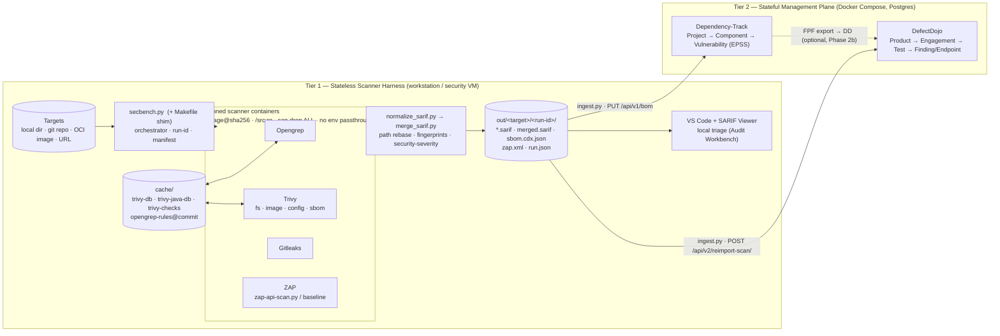

# secbench — Self-hosted AST Workbench (Fortify-equivalent)

> **Scope of this document:** Section 1 (architecture / data flow) and Section 2 (component & schema design). Sections 3–4 (phased plan, runnable code) are gated on sign-off of the decisions in §0.

## 0. Decisions requiring sign-off (adversarial review of the brief)

| # | Brief says | Pushback / decision | Rationale |
|---|-----------|---------------------|-----------|
| D1 | Standardise *all* static/IaC/secret/**dependency** findings on SARIF into DefectDojo | **Dependency (CVE) findings do NOT go to DefectDojo as SARIF.** Trivy vuln output → Dependency-Track only (via CycloneDX). DefectDojo receives SAST (Opengrep), IaC + secrets (Trivy `config`/`secret`), git-history secrets (Gitleaks) as SARIF, and ZAP as native XML. Optional bridge: DT → DefectDojo via DT's FPF export (`/api/v1/finding/project/{uuid}/export` → DD scan type *Dependency Track Finding Packaging Format (FPF) Export*). | Same CVE tracked in two systems with two dedupe engines = double triage and drift. DT is the system of record for SCA (EPSS, policy, VEX). SARIF for CVEs also drops package/fixed-version/CVSS vector fields DD's native parsers keep. |
| D2 | "Makefile / Python CLI **or Draugr**" | **Python stdlib-only `secbench.py` is the engine; `Makefile` is a thin shim.** Draugr rejected (unverifiable maintenance, adds a dependency to the trust boundary of a *security* tool). | Zero third-party Python deps = reproducible across Windows-native, WSL2, Linux VM. PowerShell can call `python secbench.py` directly; `make` is optional sugar. |
| D3 | SARIF `level` drives DefectDojo severity | **Normaliser always injects `rule.properties["security-severity"]`** (CVSS-style 0–10). | DefectDojo's SARIF parser prefers `security-severity`; without it, `level: error` maps to **Critical** (not High) in current parser code — every Opengrep `ERROR` rule would land as Critical. *(Verify against pinned DD version in Phase 2.)* |
| D4 | Suppressions as `.trivyignore`, `.opengrepignore`, VEX each with owner/justification/expiry | **Single `suppressions.yaml` is the source of truth; tool-native files are *generated*.** `.opengrepignore` is path-based only and has no per-finding metadata; `.gitleaksignore` is fingerprint-only; neither supports expiry. | One schema, one validator, expiry enforced at generation time (expired entry ⇒ not emitted ⇒ finding resurfaces). Deterministic and auditable. |
| D5 | Workstation execution | **On Windows, run from WSL2 (Ubuntu) with Docker Desktop WSL integration; clone targets onto the ext4 side (`~/src`), not `/mnt/d/...`.** | Bind-mounting `/mnt/d` through 9P is 10–50× slower for SAST; `D:\` path quoting breaks `-v` and SARIF URI normalisation. Junction `C:\Repos → D:\Repos` is already a known bridge hazard. |
| D6 | Opengrep "cross-file/inter-procedural" | Treat as **intra-file taint with cross-function propagation**; cross-file is version-dependent. Pin and verify in Phase 1. | Don't architect around a capability that may not exist in the pinned build. SpotBugs/FindSecBugs slot is kept as an *interface*, not built (no Java in current scope: .NET / Angular / RN). |
| D7 | Git history secrets: Gitleaks **or** TruffleHog | **Gitleaks.** | Native SARIF, single static binary, DD parser exists, `.gitleaksignore` fingerprint model composes with D4. TruffleHog's verification (live credential check) needs egress — conflicts with the `--network none` scanner posture. |

**Assumption (flagged):** targets are the three ISL repos (.NET backend, Angular web, React Native mobile) plus container images from the backend build. Opengrep rule packs scoped accordingly: `csharp`, `typescript`, `javascript`, `dockerfile`, `yaml`, `terraform`/`bicep` (Bicep via Trivy `config` only — Opengrep has no Bicep grammar).

---

## 1. System Architecture & Data Flow Blueprint

### 1.1 Two-tier topology



**Tier 1 invariants**

- Stateless: nothing survives a run except `out/` artefacts and `cache/` databases. A run is a pure function of `(target, commit, images.lock, rules@commit, config)` — recorded in `run.json` so any run is reproducible.
- Every scanner container: `--rm --pull never --cap-drop ALL --security-opt no-new-privileges --read-only --tmpfs /tmp -v "$TARGET:/src:ro" -v "$OUT:/out" --workdir /src --user $(id -u):$(id -g)` and `--network none` for everything except ZAP (needs the target) and explicit `prefetch` runs. No `-e` passthrough of host env; no `~/.azure`, `~/.docker`, `~/.aws` mounts. Image scanning uses `docker save` → tarball → `trivy image --input /out/image.tar` so the Docker socket is *never* mounted into a scanner.
- Tool-native paths are rebased so every SARIF `artifactLocation.uri` is repo-root-relative with `uriBaseId: "%SRCROOT%"` — the same finding from `D:\Repos\Backend`, `/home/gman/src/backend` or `/src` hashes identically.

**Tier 2 invariants**

- Two Compose stacks, two Postgres instances, separate named volumes and `.env` secrets. Only ports `8080` (DD), `8081`/`8082` (DT API/UI) on `127.0.0.1`. Images pinned by digest like the scanners.
- Tier 2 never reaches into Tier 1. All traffic is `ingest.py` → REST, authenticated by per-tool API keys stored in `.env` (git-ignored), never in the Makefile.

### 1.2 Data flow — SARIF 2.1.0 (SAST / IaC / secrets)

| Step | Component | Action | Artefact |
|------|-----------|--------|----------|
| 1 | `secbench.py` | Resolve target → `target_slug`, `git rev-parse HEAD`, `run_id = <UTC yyyymmddTHHMMSSZ>-<sha7>`; create `out/<slug>/<run_id>/` | `run.json` (seeded) |
| 2 | Opengrep | `opengrep scan --config /rules --sarif --metrics=off --output /out/opengrep.sarif /src` | `opengrep.sarif` (native fingerprints `matchBasedId/v1`, `codeFlows` for taint rules) |
| 3 | Trivy | `trivy fs --scanners misconfig,secret --format sarif --output /out/trivy-fs.sarif /src` (vuln scanner **excluded** per D1; see §1.3) | `trivy-fs.sarif` |
| 4 | Gitleaks | `gitleaks git --report-format sarif --report-path /out/gitleaks.sarif /src` | `gitleaks.sarif` |
| 5 | `normalize_sarif.py` | Per file: (a) rebase URIs → relative + `%SRCROOT%`; (b) preserve `tool.driver.name`/`semanticVersion`; (c) compute `fingerprints["secbench/v1"]`, move tool-native fingerprints to `properties.nativeFingerprints`; (d) inject `rule.properties["security-severity"]`, `tags` (`CWE-nnn`, `OWASP-…`); (e) apply `suppressions.yaml` → SARIF `suppressions[]` (kind `external`, with owner/justification/expiry in `properties`) rather than deleting results | `*.norm.sarif` |
| 6 | `merge_sarif.py` | One `sarifLog` with one `runs[]` entry per tool (never merges runs — DD and the VS Code viewer key on `tool.driver.name`) | `merged.sarif` |
| 7 | VS Code SARIF Viewer | Open `merged.sarif`; viewer resolves `%SRCROOT%` to the workspace folder; manual triage, `codeFlows` rendered inline | — |
| 8 | `ingest.py` | One `POST /api/v2/reimport-scan/` **per tool** (`scan_type=SARIF`, `test_title=<tool>`, `auto_create_context=true`, `close_old_findings=true`, `commit_hash`, `branch_tag`, `build_id=run_id`) | DD Test per tool under Engagement `<slug>` |

Why one reimport per tool and not `merged.sarif`: DD's SARIF parser iterates all runs into a single Test; `close_old_findings` then closes *every* finding not in this upload. A partial run (ZAP skipped, Gitleaks failed) would mass-close valid findings. Per-tool Tests make a tool failure a no-op for the others.

### 1.3 Data flow — CycloneDX SBOM (dependencies)

| Step | Component | Action | Artefact |
|------|-----------|--------|----------|
| 1 | Trivy | `trivy fs --format cyclonedx --scanners vuln --output /out/sbom.cdx.json /src` (one SBOM per repo; `trivy image --input /out/image.tar --format cyclonedx` for images) | `sbom.cdx.json` (CycloneDX 1.6, `serialNumber` urn:uuid, `metadata.component` = target) |
| 2 | `ingest.py` | `PUT /api/v1/bom` multipart: `projectName=<slug>`, `projectVersion=<branch>`, `autoCreate=true`, `bom=@sbom.cdx.json`; poll `GET /api/v1/bom/token/{token}` until `processing=false` | DT Project `<slug>:<branch>` |
| 3 | Dependency-Track | Analysers (OSV, NVD mirror, GitHub Advisories if token present) + EPSS (FIRST mirror); policy engine evaluates CVSS/EPSS/licence policies | Findings, policy violations, project metrics |
| 4 | *(optional)* `ingest.py --bridge-dt` | `GET /api/v1/finding/project/{uuid}/export` → `POST /api/v2/reimport-scan/` with `scan_type="Dependency Track Finding Packaging Format (FPF) Export"` | Single pane in DD; DT stays authoritative |

Trivy's **vuln** scanner runs exactly once (SBOM pass) so the CVE list is produced once and consumed by DT. The `trivy fs --format sarif` pass runs `misconfig,secret` only. Trivy JSON (`--format json`) is emitted as a side artefact for local eyeballing but is not ingested.

### 1.4 Data flow — ZAP (DAST / API)

| Step | Component | Action | Artefact |
|------|-----------|--------|----------|
| 1 | `secbench.py` | Validate `TARGET_URL` (must resolve; local targets rewritten `localhost` → `host.docker.internal` on Docker Desktop, or `--network host` on Linux) | — |
| 2 | ZAP | `zap-api-scan.py -t $TARGET_URL -f openapi -c /zap/wrk/api-scan.conf -n /zap/wrk/<ctx>.context -x /zap/wrk/zap.xml -J /zap/wrk/zap.json -r /zap/wrk/zap.html -I -T 15` (mount `config/zap/` + `out/` as `/zap/wrk:rw`, user `zap`) | `zap.xml`, `zap.json`, `zap.html` |
| 3 | `ingest.py` | `POST /api/v2/reimport-scan/` with `scan_type="ZAP Scan"`, file `zap.xml`, `test_title=zap-api`, same engagement | DD Findings + **Endpoints** (host/path/query), dedupe on endpoint set |

ZAP stays native XML (DD's ZAP parser builds Endpoint objects; SARIF would flatten them to URIs).

### 1.5 Identity model across the three stores

| Concept | secbench | DefectDojo | Dependency-Track |
|---------|----------|------------|------------------|
| Codebase | `target_slug` (from `git remote` or dir name, kebab-case) | Product = `<slug>` ; Engagement = `secbench` (CI/CD-type, long-lived) | Project name = `<slug>` |
| Branch / version | `branch` | `branch_tag` on Test | Project version = `<branch>` |
| Run | `run_id` | `build_id` on Test | `metadata.timestamp` in BOM |
| Tool | `tool.driver.name` | Test (`test_title`) | n/a (DT is the tool) |
| Finding identity | `fingerprints["secbench/v1"]` | `unique_id_from_tool` ← first `/vN` fingerprint key (dedupe algo `unique_id_from_tool_or_hash_code`) | `(project, component.purl, vuln.id)` |

---

## 2. Detailed Component & Schema Design

### 2.1 Repository layout (`gd-sec-tools/secbench/`)

```text
secbench/
├── Makefile                      # thin targets → python3 secbench.py <cmd>
├── secbench.py                   # orchestrator: stdlib only (argparse, subprocess, json, hashlib)
├── images.lock                   # name=registry/image@sha256:…  (generated; the ONLY place images are named)
├── .env.example                  # DD_URL, DD_API_KEY, DT_URL, DT_API_KEY, SECBENCH_MODE=observe|gate
├── config/
│   ├── secbench.yaml             # default scanners, severity gate, timeouts, ZAP profile per target
│   ├── suppressions.yaml         # SINGLE source of truth (schema below)
│   ├── opengrep/
│   │   ├── rules.lock            # opengrep-rules repo @ commit sha
│   │   └── rules/                # vendored subset (csharp, ts, js, dockerfile, yaml, generic/secrets)
│   ├── trivy/trivy.yaml          # cache-dir, scanners, severity, skip-dirs, offline flags
│   ├── gitleaks/gitleaks.toml    # extends default + ISL-specific allowlists
│   └── zap/
│       ├── api-scan.conf         # <ruleId>\t<WARN|IGNORE|FAIL>\t(comment)
│       ├── contexts/<slug>.context
│       └── openapi/<slug>.json   # optional local spec when target can't serve it
├── scripts/
│   ├── pin-images.sh             # resolves tags → digests, rewrites images.lock (explicit, reviewed, committed)
│   ├── prefetch-dbs.sh           # trivy --download-db-only/--download-java-db-only, trivy-checks, opengrep rules
│   ├── normalize_sarif.py        # §2.3
│   ├── merge_sarif.py
│   ├── gen_suppressions.py       # suppressions.yaml → .trivyignore.yaml / .gitleaksignore / vex.openvex.json / sarif suppressions
│   ├── check_suppressions.py     # lint: schema, expiry ≤ 180d, owner present; fails gate mode on expired
│   └── ingest.py                 # §2.4 / §2.5
├── management-plane/
│   ├── defectdojo/   docker-compose.yml  .env.example
│   └── dependency-track/ docker-compose.yml  .env.example
├── cache/                        # git-ignored; host volume for trivy-db, trivy-java-db, trivy-checks (OCI layout)
├── out/<slug>/<run_id>/          # git-ignored
│   ├── opengrep.sarif  trivy-fs.sarif  gitleaks.sarif      (raw)
│   ├── *.norm.sarif  merged.sarif                          (normalised)
│   ├── sbom.cdx.json  trivy-vuln.json                      (SCA)
│   ├── zap.xml  zap.json  zap.html                         (DAST)
│   ├── image.tar                                           (if image target; deleted after scan)
│   └── run.json                                            (manifest, §2.2)
└── docs/
    ├── 00-ARCHITECTURE.md        # this file
    ├── 10-SUPPRESSION-POLICY.md
    └── runs/                     # Dataview-queryable run log (one note per run, generated)
```

### 2.2 Run manifest (`run.json`) — the determinism contract

```json
{
  "schema": "secbench/run/v1",
  "run_id": "20261105T061200Z-a1b2c3d",
  "target": { "slug": "isl-backend", "kind": "git", "path": "/home/gman/src/backend", "commit": "a1b2c3d…", "branch": "develop", "dirty": false },
  "images": { "opengrep": "ghcr.io/…@sha256:…", "trivy": "…", "gitleaks": "…", "zap": "…" },
  "rules": { "opengrep": "opengrep-rules@<sha>", "trivy_db": "<digest>", "trivy_checks": "<digest>", "gitleaks_cfg": "<sha256 of toml>" },
  "mode": "observe",
  "steps": [ { "tool": "opengrep", "exit": 0, "duration_s": 41.2, "results": 17, "artefact": "opengrep.norm.sarif" } ],
  "suppressions_applied": 3,
  "ingest": { "defectdojo": { "test_ids": {"opengrep": 112} }, "dependency_track": { "project": "uuid", "token": "…" } }
}
```

A `docs/runs/<run_id>.md` note with the same fields as frontmatter is emitted for Obsidian/Dataview.

### 2.3 SARIF normalisation, fingerprinting, severity

**Path rebase (the dedupe root cause).** Every tool is executed with `-v "$TARGET:/src:ro" --workdir /src`; tools then emit `/src/foo/bar.cs`, `foo/bar.cs`, or `file:///src/foo/bar.cs` depending on tool. Normaliser rule:

```
uri := strip_prefix(uri, {"file:///src/", "/src/", "./"})
artifactLocation := { "uri": uri, "uriBaseId": "%SRCROOT%" }
```

`originalUriBaseIds` is deliberately **omitted** so the VS Code viewer binds `%SRCROOT%` to the open workspace, and DD hashes only `uri`.

**Fingerprint `secbench/v1`** (stable across line shifts, unstable across semantic change):

```
sha256( tool.driver.name | ruleId | uri | normalise_ws(snippet or region.startLine±0) | partialKey )
```
where `partialKey` = Opengrep `matchBasedId/v1` when present, Gitleaks secret fingerprint (`commit:file:rule:line` → commit+rule+hash(secret)), Trivy `ruleId+uri+startLine`. Written to `result.fingerprints["secbench/v1"]` and it is the **only** key in `fingerprints` (DD takes the first `/vN` key; tool-native values are kept under `result.properties.nativeFingerprints` for forensics). **Verify** the DD parser's key-selection logic against the pinned image in Phase 2 before relying on dedupe.

**Severity mapping** — normaliser sets both `level` and `rule.properties["security-severity"]`:

| Source | Native | SARIF `level` | `security-severity` | DD severity (via security-severity) | Notes |
|--------|--------|---------------|---------------------|--------------------------------------|-------|
| Opengrep | `ERROR` | `error` | from `metadata.impact`×`likelihood`×`confidence`: HIGH/HIGH/HIGH→9.0, HIGH/*/MEDIUM→7.5, else 6.0 | Critical ≥9 · High ≥7 · Medium ≥4 · Low <4 | Prevents every ERROR becoming Critical (D3) |
| Opengrep | `WARNING` | `warning` | 5.0 (4.0 if confidence LOW) | Medium | |
| Opengrep | `INFO` | `note` | 2.0 | Low | |
| Trivy misconfig | `CRITICAL/HIGH` | `error` | 9.0 / 7.5 | Critical / High | Trivy SARIF already carries `security-severity`; preserved if present |
| Trivy misconfig | `MEDIUM` | `warning` | 5.0 | Medium | |
| Trivy misconfig | `LOW/UNKNOWN` | `note` | 2.0 | Low | |
| Trivy / Gitleaks secret | any | `error` | 8.5 | High | Secrets are gated regardless of EPSS — rotation cost dominates |
| ZAP | risk High/Med/Low/Info | n/a (XML) | n/a | High/Medium/Low/Info by DD ZAP parser | |
| Dependency-Track | CVSS v3/v4 + EPSS | n/a | n/a | Only via FPF bridge (CVSS → DD severity) | EPSS/percentile stored on DT finding; policy `EPSS ≥ 0.2 OR CVSS ≥ 9` = fail |

Preserved verbatim from tool output: `codeFlows[]` (Opengrep taint), `rule.helpUri`, `rule.fullDescription`, `properties.tags` (CWE/OWASP → DD `cwe` field is parsed from `CWE-\d+` tags), `result.message.text`.

**DefectDojo `reimport-scan` field contract**

| Field | Value | Effect |
|-------|-------|--------|
| `scan_type` | `SARIF` / `ZAP Scan` / `…FPF Export` | parser selection |
| `product_name`, `engagement_name` | `<slug>`, `secbench` | with `auto_create_context=true`, `product_type_name=secbench` |
| `test_title` | `opengrep` / `trivy-config` / `gitleaks` / `zap-api` | stable Test per tool ⇒ reimport finds the same Test next run |
| `close_old_findings=true`, `close_old_findings_product_scope=false` | | findings absent from this upload (same Test) → mitigated |
| `do_not_reactivate=false` | | regressions re-open |
| `deduplication_on_engagement=true` | | fingerprints compared within engagement only |
| `minimum_severity` | `Info` (observe) / `Low` (gate) | |
| `commit_hash`, `branch_tag`, `build_id`, `version` | from `run.json` | traceability |
| `apply_tags_to_findings=true`, `tags=secbench,<branch>` | | Dataview-style filtering in DD |

**Dependency-Track `bom` contract**: `PUT /api/v1/bom`, `X-Api-Key`, multipart `projectName`, `projectVersion`, `autoCreate=true`, `parentName` optional, `bom` file. Response `{token}`; `ingest.py` polls `/api/v1/bom/token/{token}` (max 120 s) then reads `/api/v1/metrics/project/{uuid}/current` and prints critical/high/EPSS summary. CycloneDX 1.6 requires DT ≥ 4.12 — pinned.

### 2.4 Suppression governance (D4)

`config/suppressions.yaml` — one entry per suppressed finding, validated by `check_suppressions.py` (JSON-schema, stdlib `json` + hand-rolled checks):

```yaml
schema: secbench/suppressions/v1
entries:
  - id: SUP-0001
    tool: trivy            # opengrep | trivy | gitleaks | dependency-track | zap
    match:                 # exactly one selector
      vuln_id: CVE-2024-12345
      purl: "pkg:nuget/Newtonsoft.Json@12.0.3"   # optional narrowing
    owner: gman@isl         # required, must match ^[a-z0-9.-]+@isl$
    justification: "Not reachable: JSON.NET TypeNameHandling never enabled; see ADR-017"
    status: not_affected    # VEX status: not_affected | false_positive | accepted_risk | fixed_elsewhere
    created: 2026-11-05
    expires: 2027-02-05     # required; lint fails if > created+180d or in the past
    ticket: "AB#4321"       # Azure Boards / GitHub issue ref, required for accepted_risk
```

`gen_suppressions.py` emits, deterministically, into `out/<slug>/<run_id>/suppressions/`:

| Target | Generated file | Mechanism |
|--------|----------------|-----------|
| Trivy | `.trivyignore.yaml` (`vulnerabilities[].id`, `expired_at`, `statement`) + `vex.openvex.json` | passed via `--ignorefile` and `--vex` |
| Opengrep | `.opengrepignore` (paths only) + SARIF `suppressions[]` post-hoc by fingerprint | path entries from `match.path`; finding-level handled in normaliser (result kept, marked suppressed, DD imports as `false_p`/`risk_accepted`) |
| Gitleaks | `.gitleaksignore` (fingerprint lines) | mounted at `/src/.gitleaksignore` via overlay — not written into target |
| Dependency-Track | CycloneDX VEX (`vulnerabilities[].analysis.state`) uploaded via `POST /api/v1/vex` | DT native analysis state, audit-trailed |
| ZAP | `IGNORE` rows appended to `api-scan.conf` | ruleId-level only (ZAP has no finding-level ignore) |

Expired entries are **not emitted** → finding reappears → gate fails. Nothing is ever written into the scanned repo.

### 2.5 ZAP API scan configuration for manual runs

**Rule file `config/zap/api-scan.conf`** (tab-separated, generated once with `-g`, then curated):

```
# ruleId<TAB>WARN|IGNORE|FAIL<TAB>(name)
40018	FAIL	(SQL Injection)
90019	FAIL	(Server Side Code Injection)
40012	FAIL	(Cross Site Scripting (Reflected))
10021	WARN	(X-Content-Type-Options Header Missing)
10015	IGNORE	(Re-examine Cache-control Directives)   # suppressions.yaml SUP-00xx
```
Semantics: `FAIL` ⇒ non-zero exit (gate mode); `WARN` ⇒ reported only; `IGNORE` ⇒ not reported. `-I` (ignore warnings for exit code) is set in observe mode and removed in gate mode.

**Context file `config/zap/contexts/<slug>.context`** (ZAP XML context export): include regex `^https?://staging-api\.isl\.local/.*`, exclude `.*/logout.*`, `.*/health.*`; auth via header injection (`-z "-config replacer.full_list(0).description=auth -config replacer.full_list(0).enabled=true -config replacer.full_list(0).matchtype=REQ_HEADER -config replacer.full_list(0).matchstr=Authorization -config replacer.full_list(0).replacement=Bearer\ $ZAP_TOKEN"`); token read from `.env` at run time, never in the context file.

**Target resolution for local/staging**

| Host OS | Target on host | Invocation |
|---------|----------------|------------|
| Linux VM | `http://localhost:5000` | `--network host`, URL unchanged |
| Windows + Docker Desktop (WSL2) | `http://localhost:5000` | URL rewritten to `http://host.docker.internal:5000`; `-O localhost:5000` keeps the Host header |
| Any | staging FQDN | default bridge network; `--network none` posture is **lifted only for the ZAP step** |

Spec sources: `-f openapi` with `-t <url-to-spec>` or `-t /zap/wrk/openapi/<slug>.json`; `-f soap` for WSDL; `-f graphql` with `-t <endpoint>` plus `-z "-config graphql.schemafile=/zap/wrk/schema.graphql"` when introspection is disabled. `-T 15` caps runtime; `-S` (safe mode) for first run against anything with side-effects.

### 2.6 Supply-chain hardening of the harness itself

- `images.lock` is the only place an image is named; `secbench.py` refuses to run if any entry lacks `@sha256:`. `scripts/pin-images.sh` is the *only* mutator and its diff is reviewed in a PR (Azure DevOps or GitHub — platform-agnostic).
- Rule packs are vendored at a commit (`rules.lock`), not pulled at scan time.
- Prefetch (`make prefetch`) is the only networked step for Trivy/Opengrep: `trivy --cache-dir /cache image --download-db-only`, `--download-java-db-only`, `trivy --cache-dir /cache config --download-db-only` (trivy-checks). Scans run `--skip-db-update --skip-java-db-update --skip-check-update --offline-scan --disable-telemetry --skip-version-check` under `--network none`.
- Cache is a host directory (`secbench/cache/`), not a Docker volume, so it can be rsync'd to an air-gapped VM.

---

## 3–4. Implemented

D1–D7 signed off 2026-11-06. Section 3 lives in [[20-IMPLEMENTATION-PLAN]]; Section 4 is the code in this directory
(`secbench.py`, `Makefile`, `scripts/`, `management-plane/`, `docker/opengrep/`). Deviations from this document
recorded in the `amendments` frontmatter field above.
